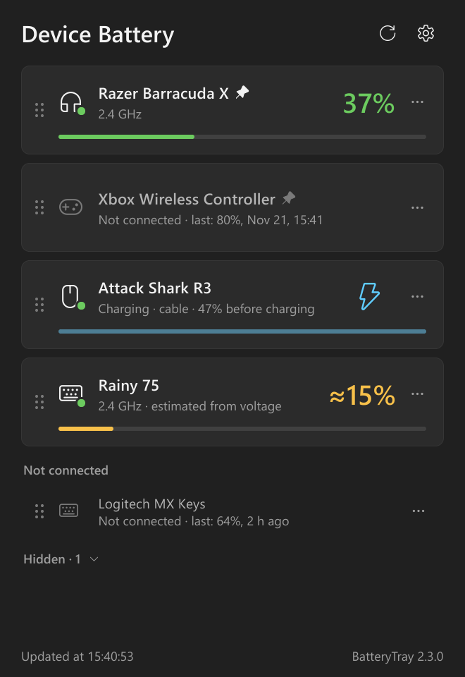
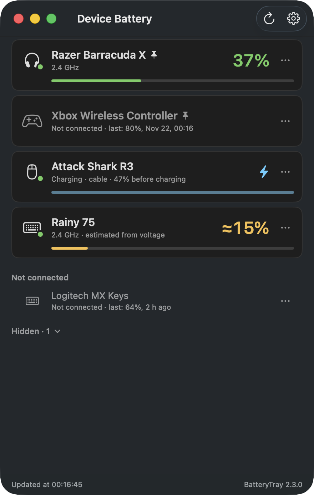
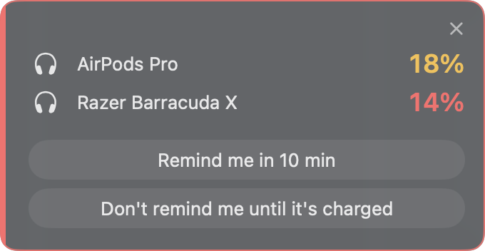
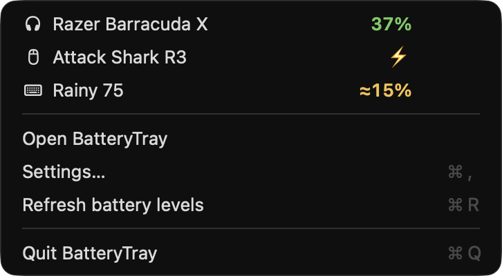
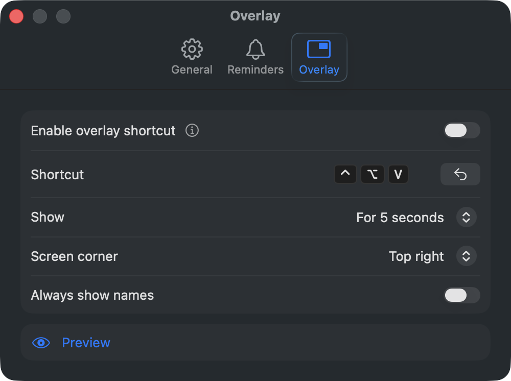

# BatteryTray — battery level of wireless headsets, mice, keyboards and controllers on Windows and macOS

[](https://github.com/qu1ncky/BatteryTray/releases/latest)
[](https://github.com/qu1ncky/BatteryTray/releases)
[](LICENSE)


**English** · [Русский](README.ru.md) · [中文](README.zh-CN.md)

See how much battery your wireless headset, mouse, keyboard and controller have left — next to the clock on Windows, in the menu bar on a Mac — and get a reminder **before** they die mid-game or mid-call. One small free app for all your devices instead of Razer Synapse, Logitech G HUB, SteelSeries GG, HyperX NGENUITY, Corsair iCUE or ASUS Armoury Crate: no account, no vendor software, it only reads the battery. On a Mac it also shows your AirPods (each earbud and the case), Magic Mouse and Keyboard, Bluetooth headsets, and an iPhone or iPad on a cable.

<p align="center">
  <a href="https://github.com/qu1ncky/BatteryTray/releases/latest/download/BatteryTray.exe"></a>
  &nbsp;&nbsp;
  <a href="https://github.com/qu1ncky/BatteryTray/releases/latest/download/BatteryTray-macOS.dmg"></a>
</p>
<p align="center"><sub>Windows 10 and 11 · macOS 13 Ventura or later, Apple Silicon and Intel · free and open source (MIT)<br><a href="#download-and-install">How to install</a> · <a href="https://github.com/qu1ncky/BatteryTray/releases">All versions and release notes</a></sub></p>

<p align="center">
  
  
</p>

## Features

- **The level always in sight** — in the Windows tray or the Mac menu bar, the number of the device that most needs charging: green, yellow below its reminder level, red below its critical level, blue while charging. Hover it (Windows) or click it (Mac) to see every device.
- **All devices in one window** — connected ones as cards with their percentage, the rest with the last known level and when it was seen. Each device's **⋯** menu renames it, pins it to the top or hides it under "Hidden"; drag a card to change the order (the overlay and the tray follow it).
- **New devices show up by themselves** — plug in a receiver or connect a Bluetooth headset and it appears within seconds. If that ever gets in the way, turn off **Look for new devices automatically** in Settings → General: new devices then wait for the refresh button, the levels of the ones already found keep updating.
- **Low battery reminder that can't be missed** — its own always-on-top window in the corner, not a toast: Do Not Disturb doesn't hide it, it doesn't time out and it doesn't steal focus from a game. "Remind me in N min" or "Don't remind me until it's charged"; at the critical level it comes back even if snoozed.

  

- **A level for every device** — the headset that drains fastest can remind you at 40% while the mouse waits for 15%: each device can have its own reminder and critical levels (in its **⋯** menu), and follows the global ones until you set them.
- **Battery overlay** — a shortcut (**Ctrl+Alt+V** on Windows, **⌃⌥V** on a Mac, set it in **Settings → Overlay**) shows the connected devices for five seconds on the screen you work on, over games and full-screen apps, without taking focus. Press again to restart the timer, or choose toggle mode; pick a corner and preview it before enabling.
- **Charging complete notification** — when a device that can tell finishes charging with the cable still in.
- **No made-up percentages** — when a device can't report its level while charging, you see a charging sign instead of a stale number; estimates are marked with "≈".
- **English, Russian and Chinese** — follows the system's language, switch any time in Settings → General.
- **Updates itself** from GitHub releases (SHA-256 checked), quietly, while its windows are closed.
- **Light** — one ~10 MB exe or an ~11 MB Mac app, about 8 MB of memory; nothing else to install, never changes anything on your devices.

## Windows and macOS

The same app on both: the device list, the reminders, the overlay and every supported device come from one shared core, and each platform gets the windows its users expect.

| | Windows | macOS |
|---|---|---|
| The level | number in the tray, next to the clock | number in the menu bar, with a menu of every device |
| Settings | in the main window (gear) | their own window, **Settings… (⌘,)**: General, Reminders, Overlay |
| Low battery reminder | always-on-top window, bottom right | floating panel, top right, never takes focus |
| Overlay shortcut | **Ctrl+Alt+V** | **⌃⌥V** (any shortcut with ⌘, ⌃ or ⌥) |
| Starts at sign-in | Task Scheduler task (installed) or the Startup setting | login item, **Open at login** |
| Bluetooth devices | the level Windows shows in Settings → Bluetooth & devices, read fresh from a Bluetooth LE device's Battery Service; AirPods with each earbud and the case; Magic Keyboard; Xbox and Switch controllers | the levels macOS knows: AirPods with each earbud and the case, Magic devices, headsets, controllers; any Bluetooth LE device with a Battery Service; Logitech MX over Bluetooth |
| Phones and tablets | Android on a cable, in File transfer mode | iPhone and iPad on a cable or on Wi-Fi |
| UPS | a UPS on USB (what Windows shows as a battery) | — |
| Xbox Wireless Adapter | yes (XInput) | no: macOS has no driver for it |
| Permissions | admin rights only when a third-party driver locks a receiver | Input Monitoring, only for keyboards (macOS asks it of every app that opens one) |
| Processor | x64 | one app for Apple Silicon and Intel |

### On a Mac



- **The level in the menu bar** — click it for every device's level and the commands; the device window and **Settings… (⌘,)** open from there.
- **Bluetooth** — everything macOS shows a level for: AirPods with both earbuds and the case, Magic Mouse, Magic Keyboard, Magic Trackpad, headsets that report their level over Bluetooth (the Razer Barracuda X in its Bluetooth mode, for one), Xbox and other controllers (through the GameController framework).
- **iPhone and iPad on a cable** — with their level and charging, once the device trusts this Mac (as Finder asks). Over Wi-Fi they aren't read, so the app needs no Local Network permission.
- **The reminder** is a floating panel in the top right corner; "Charging complete" and "a new version" are macOS notifications.



## Supported devices

| Devices | Connection | Status |
|---|---|---|
| **Razer Barracuda X** (2022) | USB-C 2.4 GHz dongle (`1532:0550`) | ✅ tested |
| Razer Barracuda X (2022), dongle `1532:0552` | 2.4 GHz | ⚠️ untested |
| **Razer headsets**: BlackShark V2 HyperSpeed, BlackShark V2 Pro (2020 and 2023), BlackShark V3, BlackShark V3 X HyperSpeed, Kraken V4 / V4 Pro, Kraken Kitty V3 Pro, Barracuda Pro | receiver or cable | ⚠️ untested |
| **Razer mice**: Viper Ultimate / V2 Pro / V3 Pro / V4 Pro / Mini SE, DeathAdder V2 Pro / V3 Pro / V3 HyperSpeed / V4 Pro, Basilisk Ultimate / V3 Pro / V3 Pro 35K / V4 Pro / V4 HyperSpeed / X HyperSpeed, Naga Pro / V2 Pro / V3 Pro, Cobra Pro / HyperSpeed, Pro Click (Mini, V2), Lancehead, Mamba, Orochi V2, Atheris and more — about 45 models | HyperSpeed receiver or cable | ⚠️ untested |
| **Razer keyboards**: BlackWidow V3 Pro / V3 Mini / V4 Mini / V4 TKL HyperSpeed, BlackWidow V4 Low-Profile (and TKL) HyperSpeed, DeathStalker V2 Pro (and TKL), Pro Type Ultra / Ergo, Joro | receiver or cable | ⚠️ untested |
| **Logitech** mice, keyboards and other HID++ devices: MX Master / Anywhere, MX Keys, G Lightspeed series, M and K series and more | Unifying / Bolt / Lightspeed / Nano receiver or cable | ⚠️ untested |
| **Logitech G headsets**: G533, G535, G633 / G635 / G733 / G933 / G935, G PRO / PRO X Wireless, G PRO X 2 LIGHTSPEED, G PRO X 3 LIGHTSPEED, G522 LIGHTSPEED, G930 | receiver | ⚠️ untested |
| **ASTRO** headsets: A50 (Gen 4, Gen 5), A50 X, A20 X | base station, transmitter or cable | ⚠️ untested |
| **SteelSeries** mice: Aerox 3 / 5 / 9 Wireless, Aerox 3 Wireless Gen 2, Prime Wireless, Prime Mini Wireless, Rival 3 Wireless (and Gen 2), Rival 650 Wireless | receiver or cable | ⚠️ untested |
| **SteelSeries Arctis Nova 5** | receiver (`1038:2232`) | ✅ tested by a user |
| **SteelSeries Arctis** headsets: 1, 7, 9, Pro Wireless, 7+, Nova 3P, Nova 7 (7X, 7P, Gen 2), Nova Pro Wireless, Nova Pro Omni, Nova Elite, GameBuds | receiver or base station | ⚠️ untested |
| **HyperX Cloud III Wireless** | receiver | ✅ tested by a user |
| **HyperX** headsets: Cloud Alpha Wireless, Cloud Alpha 2 Wireless, Cloud II Wireless, Cloud II Core Wireless, Cloud III S Wireless, Cloud Flight, Cloud Flight S, Cloud Stinger 2 Wireless, Cloud Stinger Core Wireless (PlayStation and DTS receivers) | receiver | ⚠️ untested |
| **HyperX** mice: Pulsefire Haste 2 Wireless / Core / Mini, Pulsefire Haste Wireless, Pulsefire Dart | receiver or cable | ⚠️ untested |
| **Corsair HS80 RGB Wireless** | receiver | ✅ tested by a user |
| **Corsair** headsets: Void series, HS70, Void v2 / Virtuoso MAX / HS80 MAX Wireless, Virtuoso, Virtuoso XT / SE | receiver or cable | ⚠️ untested |
| **Corsair** mice and keyboards on a SLIPSTREAM receiver or their own: Dark Core RGB Pro / Pro SE, Scimitar Elite Wireless, Ironclaw, Harpoon, Sabre RGB Pro, M65 Ultra, M75 / M75 Air, M55, Nightsabre, Darkstar, Katar Pro Wireless; K57, K65 Plus, K70 Core TKL, K70 Pro Mini, K100 Air, MAKR 75 | receiver or cable | ⚠️ untested |
| **Corsair** Sabre v2 Pro Wireless (Ultralight, MG, CF) | receiver or cable | ⚠️ untested |
| **ASUS ROG** mice: Chakram / Chakram X, Gladius II / III Wireless (and AimPoint), Harpe Ace (Aim Lab, Extreme, Mini), Harpe II Ace, Keris Wireless (and AimPoint), Keris II Ace / Origin, Pugio II, Spatha X, Strix Impact II / III Wireless, Strix Carry; TUF Gaming M4 Wireless, TX Gaming Mini and others | own receiver, ROG Omni Receiver, SpeedNova 8K receiver or cable | ⚠️ untested; the older ones report in steps of 25% |
| **ASUS ROG** keyboards: Azoth, Azoth Extreme, Azoth X, Falchion, Falchion RX Low Profile, Strix Scope II 96 Wireless, Strix Morph 96 Wireless | own receiver, ROG Omni Receiver or cable | ⚠️ untested |
| **ASUS ROG** headsets: Pelta, Delta II, Cetra True Wireless SpeedNova, Cetra Open Wireless, Strix Go 2.4 | 2.4 GHz dongle | ⚠️ untested |
| **Attack Shark R3** | 2.4 GHz receiver (`3151:402D`) | ✅ tested |
| **AJAZZ AJ179 Pro** mouse | 2.4 GHz receiver (`3151:402D`, the same IDs as the R3's) | ✅ tested by a user |
| Other mice and keyboards on the Rongyuan platform (Attack Shark, Akko, MonsGeek and others, 88 receiver models) | 2.4 GHz receiver | ⚠️ untested |
| Attack Shark X82 PRO HE keyboard | 2.4 GHz receiver (`3151:5026`) | ✅ tested by a user; the level reads too high while charging (see below) |
| Attack Shark V3 Pro mouse | 2.4 GHz receiver (`1D57:FA60`), charging dock | ✅ tested by a user |
| Other mice on the Xenta receivers: **Attack Shark** X11, X11 SE, X11 Pro, X3, X3 Max, X3 Pro, X1, X6 / R1, V3, V6, X8 Pro, X8 SE, X8 Plus, G3 Pro, **FURYCUBE** F1, F1 Pro, F3, G3, G9, G9 PRO, G11, G13S, **Delux** M600 Pro / M900 Pro / M900 Mini, **Inphic** IN6 / IN6 SE, IN9 / IN9 Ultra / In9 Pro, IN10 / IN10 MAX, INX, **MAMBASNAKE** M3 | 2.4 GHz receiver (`1D57:FA60`, `1D57:FA65`) or cable | ⚠️ untested |
| **VXE / VGN** mice: R1 PRO / PRO MAX, R1 SE / SE+, Dragonfly R1, Dragonfly F2 | 2.4 GHz receiver or cable | ⚠️ untested |
| **ATK A9 Ultra Max 2.0** mouse | 2.4 GHz receiver (`373B:11FE`) | ⚠️ untested |
| Other **ATK** mice: whatever is on its 1K, 8K and NearLink receivers (X1, A9, F1, U2 series and others), ATK ZERO, VXE R1 NK | 2.4 GHz receiver; X1 Pro Max, A9 Plus, A9 Ultimate, A9 Mini+, F1 Ultimate 2.0 also on the cable | ⚠️ untested |
| Mice with CompX's protocol: **Lamzu** Atlantis / Thorn, **Scyrox** V8 / V8S / V6, **Pulsar** X2 V2 and the CrazyLight 8K dongle, **G-Wolves** HTX Ultra and its 8K receiver, Kysona M600, Hitscan Hyperlight, Cougar Revenger Pro, Dareu A950 Wing / EM901X, HECATE G5M PRO, CHERRY XTRFY, GravaStar, Redragon M916 Pro / M991, **Endgame Gear** XM2we / OP1we | 2.4 GHz receiver or cable | ⚠️ untested |
| Mice on the **Areson** receivers `25A7:FA7C` (Redragon M693, Fantech Helios Go XD5 and others under their own names) and `25A7:FA07` / `FA08` (Redragon M915RGB-WL, M913) | 2.4 GHz receiver or cable | ⚠️ untested; FA07 / FA08 report in steps of 10% |
| **Ardor Renegade** mouse | 2.4 GHz receiver (`25A7:FA4A`) | ✅ level tested by a user; the mouse reports it in steps of 10% |
| Mice on the receiver `A8A5:2255`: **AJAZZ AJ139 V2 MC**, K-Snake X11, Noir M2-NEX, MCHOSE G7 Pro; **MCHOSE G3 V2** (`3837:4245`) | 2.4 GHz receiver or cable | ⚠️ untested |
| **Glorious** mice: Model O / O- / D / D- Wireless, Model O PRO, Series One PRO, Model O 2 PRO / D 2 PRO (and the 4K/8KHz Editions), Series 2 PRO | 2.4 GHz receiver or cable | ⚠️ untested |
| **LAMZU** mice of the Aurora generation: Maya X, Maya, Inca, Tachi, Paro, Thorn, Atlantis OG Champion, Atlantis Mini, Orcus and others | 2.4 GHz receiver (1K, 8K) or cable | ⚠️ untested |
| **WLmouse** Beast X (Pro, Mini, Max, V2), Beast G, Beast Miao, Huan, Strider, Ying, Sword X; **G-Wolves** Fenrir, HTX, HTS, HSK, HTR, HT-S2 series; Arbiter Studio Akitsu; Attack Shark R5 Ultra / R6 / R8; CRDRAKO KO-ONE; LunaFury LUNA33 / TYPE33 | 2.4 GHz receiver or cable | ⚠️ untested |
| **MCHOSE** mice: A5 Pro / Pro Max, L7, M7, A7, K7 and their V2 / V3 / Pro / Ultra versions, A5 V2 / V3, K5, R7 Ultra, V7, G3 V3 | 2.4 GHz receiver or cable | ⚠️ untested |
| **Keychron** mice: M1 – M7 on the Link receiver, the 4K mice on the 4K Link, the 8K mice (M5 8K, M6 8K and others) on the Ultra-Link 8K, Nape Pro | 2.4 GHz receiver or cable | ⚠️ untested |
| **Pulsar** X2 V3, X2 V3 eS, and the Xlite V4 / X3 on the same dongles | 2.4 GHz dongle or cable | ⚠️ untested |
| **VAXEE / ZYGEN** mice (XE, XE-S, XE V2, AX, E1, NP-01, NP-01S), **Ninjutso** Sora V2 and Ten / Ten Air, Sprime PM1, **Endgame Gear** OP1w 4k / XM2w 4k, **Cooler Master** MM712 / MM731, **ZOWIE** EC1-CW / EC2-CW / EC3-CW, ROCCAT Kone Pro Air, **Finalmouse** UltralightX | 2.4 GHz receiver or cable | ⚠️ untested; VAXEE reports in steps of 5%, the Finalmouse level is an estimate |
| **Rapoo** VT gaming mice (VT0 – VT9 lines, about 70 models), **Incott** mice on the 8K receiver (G23, G23 V2, G24, Ghero, Zero 29 / 39) | 2.4 GHz receiver or cable | ⚠️ untested; an Incott mouse appears once it has been moved |
| Machenike L7, Darmoshark M3 / M3S / M3S Pro, MSI VERSA 300 ELITE WIRELESS and CLUTCH GM31 LIGHTWEIGHT WIRELESS, AJAZZ AJ179, AULA SC580 and X9 Ultra / V9 Max+, Akko V9 Dash Pro / Dash V9 Ultra, Delux M800 Pro, DAREU A980 Pro, Royal Kludge MG6 Pro, Niceboy MW400, mice on Sinowealth's receiver `258A:002F` (Redragon M602-KS and others) | 2.4 GHz receiver or cable | ⚠️ untested |
| Keyboards on CompX's "BY" receivers: **MCHOSE** (K99 V2, G75 Pro, X75, G87, K87 and others), **AULA** (F75, F75 Max, F87 Pro, F99), **VGN** (V98 Pro V3, V87 V2, N75 V2, V108), Redragon Horus Pro | 2.4 GHz receiver (`3554:FA09`, `3554:FB40`, `41E4:2001`, `258A:024F` and others) | ⚠️ untested |
| Keyboards on SONiX dongles: **Attack Shark X85**, EWEADN X87, **AJAZZ** AK820 Pro / MAX / Max Plus, EPOMAKER EA75, **AULA** F87 Pro V2 / F99 MAX / F108 Pro and others | 2.4 GHz receiver (`0C45:FEFE`, `0C45:FDFD`, `0C45:FEFC`, `05AC:024F`) | ⚠️ untested; no charging sign |
| **CHERRY** MX 3.0S Wireless, MX 2.0S Wireless / WL Pro, PIXIU 75; **ATK** V75X, Z87; **VGN / VXE** S99, V98 Pro, N75 Pro, VXE75, V87 on the receiver `320F:5088`; AJAZZ AK992; Attack Shark X98; URX Core75; MCHOSE K87 V3; **Alienware** Pro Wireless Gaming Keyboard | 2.4 GHz receiver or cable | ⚠️ untested |
| **Audeze** Maxwell / Maxwell 2, AKG N9 Hybrid, Skullcandy PLYR / Crusher PLYR 720, **Alienware** AW920H, **EPOS** H3PRO Hybrid, Fractal Design Scape, MOONDROP GM01 Pro | dongle or cable | ⚠️ untested |
| **JBL Quantum** 350 / 360 / 520 / 610 / 650 / 810 / 850 / 910 / 950 Wireless | dongle or cable | ⚠️ untested |
| **Jabra** headsets on a Link 380 / 390 adapter, Evolve2 65 Flex and Evolve3 75 on the cable; **Poly** Voyager UC headsets on the BT600 adapter | USB adapter or cable | ⚠️ untested |
| **Sony** INZONE H5, INZONE H9 II, INZONE Buds, PULSE 3D; **MCHOSE** X9, V9 Pro, V9 Pro 2; FIFINE HT6; VGN OMNISOUND; Lenovo Wireless VoIP | receiver | ⚠️ untested |
| **Sony DualSense**, DualSense Edge, DualShock 4 | cable, Sony adapter; Bluetooth once a game or Steam has switched the controller to full reports | ⚠️ untested |
| **Steam Controller** (2026) on its Puck, Steam Controller (2015) on its wireless adapter | receiver | ⚠️ untested |
| **8BitDo** Ultimate 2 Wireless, **Flydigi** Vader 5 Pro / Apex 5 / Apex 6, **GameSir** Nova 2 / Nova 2 Lite / Super Nova / Tarantula Pro, BEITONG KP40D | 2.4 GHz receiver | ⚠️ untested; Flydigi reports in steps |
| NVIDIA SHIELD Controller (2017) | cable | ⚠️ untested |
| **Xbox controllers** via the Xbox Wireless Adapter (XInput, Windows only: macOS has no driver for the adapter) | adapter | ⚠️ untested; XInput only knows 4 levels |
| **Xbox controllers** on Bluetooth Classic, as their original firmware connects them: Xbox One S (`045E:02E0`, `02FD`), Elite Series 2 (`0B05`) (Windows only) | Bluetooth | ⚠️ untested; 4 levels, shown once the controller has sent its battery report |
| **Nintendo Switch** Pro Controller, Joy-Con (Windows only) | Bluetooth, once a game or Steam has switched the controller to full reports | ⚠️ untested; 5 levels |
| **Apple Magic Keyboard** (2015, 2021, USB-C; with Touch ID and with Numeric Keypad) (Windows only) | Bluetooth | ⚠️ untested |
| **Any Bluetooth device** whose battery Windows or macOS shows (Xbox controller, AirPods with each earbud and the case, Magic Mouse / Keyboard / Trackpad, many mice, keyboards and headsets) | Bluetooth | ✅ tested on Windows (Xbox controller) and macOS (Razer Barracuda X in Bluetooth mode, AirPods) |
| **iPhone, iPad** (macOS) | USB cable, or Wi-Fi with "Show this iPhone when on Wi-Fi"; the device must trust the Mac | ✅ tested on the cable (iPhone, iOS 26) |
| **Bluetooth LE devices** with the standard Battery Service: many mice and keyboards (Logitech MX, keyboards with ZMK and both halves of a split one), trackers | Bluetooth LE | ⚠️ untested; on Windows read fresh from the device, on a Mac with the Bluetooth permission |
| **Logitech MX** mice and keyboards connected directly over Bluetooth (macOS; Windows shows them itself) | Bluetooth LE | ⚠️ untested |
| **AirPods and Beats** with each earbud and the case on Windows | Bluetooth | ⚠️ untested |
| **Android phones and tablets** (Windows) | USB cable in "File transfer" mode | ⚠️ untested |
| **UPS** (Windows): the ones Windows shows as a battery | USB | ⚠️ untested |
| **Game controllers** macOS knows: Xbox, Switch Pro, MFi and others | Bluetooth (macOS) | ⚠️ untested |
| Any USB device that reports the standard HID "Battery Strength" | receiver or cable | ⚠️ untested |

Every device in the table is read on macOS too, through the same protocols (macOS 13 or later, Apple Silicon or Intel), except the rows marked Windows only: macOS shows those Bluetooth devices itself, and has no driver for the Xbox Wireless Adapter.

"Untested" means it follows the protocol as documented by the open source projects listed in [How it works](#how-it-works), but nobody has confirmed it on the real device yet — if you have one, please report how it went in [Issues](https://github.com/qu1ncky/BatteryTray/issues).

Notes on specific devices:

- **Razer Barracuda X** sends its own percentage through the dongle whenever it changes by 1%. Until it has sent one (right after the app starts), the level is estimated from the battery voltage and shown with "≈". While charging there is no percentage at all — the headset's number only creeps towards 100% at a fixed pace — so you see that it's charging, when it's almost full and when it's done.
- **Attack Shark / Rongyuan mice** on their cable leave the receiver and report no level over the cable (the vendor's own driver doesn't show one either), so they show as charging, and the receiver reports the real level once the cable is out.
- **Attack Shark X82 PRO HE** keyboard stays on its receiver while it charges on the cable, but reports a level 20–30% too high then, and the real one again once the cable is out. Most likely the keyboard estimates its level from the battery voltage, which the charger raises. Nothing tells that the keyboard is on the cable: the receiver's reply stays the same, no USB device appears, and the vendor's own driver shows the same inflated level. So the number is shown as it comes ([#5](https://github.com/qu1ncky/BatteryTray/issues/5)).
- **Mice on the Xenta receiver** (`1D57:FA60`: Attack Shark, FURYCUBE, Delux, Inphic, MAMBASNAKE) send their level by themselves every 2 seconds; BatteryTray only listens and sends them nothing. On the cable or the charging dock the number they send stays frozen, so you see a charging sign instead, and the real level is back a few seconds after the mouse leaves the charger. The model is told by a code in these messages: a mouse whose code isn't known yet is listed without a level and its messages go to the log, so please post the `Xenta` lines from `%LOCALAPPDATA%\BatteryTray\log.txt` in [Issues](https://github.com/qu1ncky/BatteryTray/issues) to get it added.
- **Receivers that several brands share.** Many cheap 2.4 GHz receivers carry the same USB IDs under unrelated products. A device on such IDs is listed once it has answered for the first time, so that nobody gets a keyboard they don't own sitting in the list as "asleep"; until then it is asked less and less often. If yours is in the table and doesn't appear, wake it up and give it a minute, and if it still doesn't, post `log.txt` in [Issues](https://github.com/qu1ncky/BatteryTray/issues).
- **Keyboards** are asked every 5 minutes at most (some every 35), because a request can keep a keyboard from falling asleep.
- **Razer BlackShark V3** is asked once every five minutes: asked more often, the headset drops its 2.4 GHz link. So its level can be a few minutes old.
- **ASUS ROG Omni Receiver**: a mouse and a keyboard on one receiver are listed separately.
- **ASTRO A50** base stations must have their switch on PC, and can't be read while ASTRO Command Center is open.
- **Sony PULSE 3D** and **Incott** mice only report when something changes, so they appear a little after they are switched on or moved.
- **Bluetooth** devices are listed only while connected: Windows keeps a stale percentage after they disconnect. On a Mac a Bluetooth device appears once it is connected and macOS has its level.
- **iPhone and iPad** (Mac) are read on the cable only, and only once they trust this Mac — BatteryTray never asks to pair, so if yours isn't listed, connect it once in Finder and tap "Trust".
- **On a Mac, keyboards and mice with keyboard keys** can only be read with the **Input Monitoring** permission (macOS asks it of every app that opens such a device). Such a device says "needs the Input Monitoring permission" until you allow it: click "Allow" on the banner above the list, or turn BatteryTray on in System Settings → Privacy & Security → Input Monitoring. BatteryTray reads only the battery level, never what you type.

## Download and install

### Windows

1. Click **Download for Windows** above (it is `BatteryTray.exe` from the [latest release](https://github.com/qu1ncky/BatteryTray/releases/latest)) and run it.
2. **Windows may warn about an unknown app** because the exe isn't code-signed: click "More info" → "Run anyway".
3. The number appears next to the clock. Windows 11 hides new icons behind the **^** arrow — drag it onto the taskbar to keep it in sight. "Enable" on the banner above the device list makes it start with Windows.

That's all it takes. If Windows keeps a device from the app (some third-party drivers lock a receiver to administrators), a line above the device list offers "Grant rights": it installs the app properly, with one UAC prompt.

**Full install:** download `BatteryTray-…-win-x64.zip` from [Releases](https://github.com/qu1ncky/BatteryTray/releases/latest), unzip it and run `install.cmd`. It installs to `C:\Program Files\BatteryTray` and starts at sign-in through a Task Scheduler task named "BatteryTray", with the rights such drivers need. To remove it, run `uninstall.cmd` from the zip.

### macOS

1. Click **Download for macOS** above (it is `BatteryTray-macOS.dmg` from the [latest release](https://github.com/qu1ncky/BatteryTray/releases/latest)), open it and drag **BatteryTray** onto **Applications**.
2. Open it from Applications. The app isn't notarized by Apple, so the first time macOS refuses to open it: go to **System Settings → Privacy & Security**, scroll down and click **Open Anyway** (on macOS 13 and 14 you can also Control-click the app and choose **Open**). Opened from anywhere else, the app offers to move itself into Applications.
3. The number appears in the menu bar. macOS asks for the Bluetooth permission: click **Allow**. Turn on **Open at login** with "Enable" on the banner above the device list.

#### Permissions on a Mac

macOS asks for each of them by itself, once, when it is first needed:

| Permission | When it's asked | What for | How |
|---|---|---|---|
| Bluetooth | at the first start | the level of Bluetooth LE devices macOS doesn't show itself (read from their Battery Service) | **Allow** in macOS' dialog |
| Local Network (macOS 15+) | when an iPhone or iPad is on the same Wi-Fi | the iPhone's and iPad's level over Wi-Fi | **Allow** in macOS' dialog |
| Input Monitoring | only when a keyboard, or a mouse with keyboard keys, is connected | macOS lets an app open such a device only with it, even to read its battery | "Allow" on the banner above the list, then turn BatteryTray on in the System Settings pane macOS opens — no app can turn this one on for you |
| Notifications, login item | not asked | "Charging complete", "a new version"; **Open at login** | macOS shows "Background item added" once |

Nothing else: no Accessibility, no Screen Recording, no administrator password (except to update a copy in an administrator's Applications folder).

**Limits of an app without an Apple Developer ID.** The app is signed ad hoc, not with Apple's paid Developer ID, and isn't notarized. So macOS needs **Open Anyway** once, and after an update it may ask for the permissions above again, because it sees each version as a different app.

Settings and the log are in `~/Library/Application Support/BatteryTray`, the login item is `~/Library/LaunchAgents/io.github.qu1ncky.BatteryTray.plist`. To remove the app, turn **Open at login** off, quit it from its menu and move it to the Trash.

## FAQ

**How do I see my Razer Barracuda X battery on PC without Razer Synapse?**
Install BatteryTray: it reads the headset through its USB-C 2.4 GHz dongle, no Bluetooth or Synapse needed.

**How do I check my Logitech mouse or keyboard battery without G HUB or Options+?**
BatteryTray asks the device over Logitech's HID++ protocol through the Unifying, Bolt or Lightspeed receiver.

**Can it show my Bluetooth headphones' battery?**
Yes, if the system itself knows it: on Windows, when Settings → Bluetooth & devices shows a percentage; on a Mac, when the Bluetooth menu does. BatteryTray shows it in the tray or the menu bar too.

**How do I see my AirPods, Magic Mouse or Magic Keyboard battery in the Mac menu bar?**
Install BatteryTray for macOS: it lists every Bluetooth device whose level macOS knows, AirPods with each earbud and the case, next to your gaming headset, mouse and keyboard.

**Can it show my iPhone or iPad battery on a Mac?**
Yes, on a cable, or on Wi-Fi when "Show this iPhone when on Wi-Fi" is on in Finder, once it trusts the Mac (Finder asks for that the first time you connect it): its level and whether it charges, in the list and the menu bar.

**And my Android phone on Windows?**
Yes, while it is on the cable in "File transfer" mode (in "Charging only" Windows doesn't see it as a device).

**A new device doesn't show up / I'd rather the app didn't look for devices by itself.**
Devices appear within seconds of connecting. Press "Refresh battery levels" to look right away; to turn the automatic search off, uncheck **Look for new devices automatically** in Settings → General (the levels of the devices already found keep updating).

**Does it work on a Mac with Apple Silicon (M1, M2, M3, M4) and on Intel Macs?**
Yes, the macOS app is one universal app for both, macOS 13 Ventura or later.

**How do I check my Razer, Logitech, SteelSeries or Corsair battery on a Mac without their software?**
The same way as on Windows: BatteryTray talks to the device's receiver over USB (IOKit on a Mac) with the device's own protocol.

**Why does the Mac app ask for Input Monitoring?**
macOS lets an app open a keyboard, or a mouse that also has keyboard keys, only with that permission, even to read its battery. BatteryTray asks for it only when such a device is connected, and only reads the battery.

**Why does it ask for administrator rights (Windows)?**
On some PCs third-party drivers lock a receiver's service channel to administrators — for example the G-SPY driver (`vkbms.inf`) that comes with some cheap keyboards takes every HID collection with usage `FF00:0001`, the Razer dongle included. The installed app therefore starts through a scheduled task with highest privileges (no UAC prompt at each sign-in) and lives in Program Files, where its exe can't be swapped without admin rights. Without that driver, normal rights are enough.
If the app runs without admin rights and Windows keeps a device from it, a line above the device list says so: "Grant rights" installs the app as `install.cmd` does, with one UAC prompt, no zip needed.

**Why is there no percentage while my device charges?**
Some devices don't report their level on the cable (or report a number that has nothing to do with the real charge). BatteryTray then shows that it's charging rather than a stale or made-up number.

**My device isn't listed.**
Run this in PowerShell while the device is connected and post the output in [Issues](https://github.com/qu1ncky/BatteryTray/issues):

```powershell
Get-PnpDevice -PresentOnly | ? InstanceId -match '^USB\\VID_\w{4}&PID_\w{4}\\' | % { "{0}  {1}" -f $_.InstanceId.Substring(4,17), (Get-PnpDeviceProperty -InstanceId $_.InstanceId -KeyName DEVPKEY_Device_BusReportedDeviceDesc).Data }
```

A diagnostic poll helps too: `"C:\Program Files\BatteryTray\BatteryTray.exe" --dump "%USERPROFILE%\Desktop\battery.txt"`, plus the log in `%LOCALAPPDATA%\BatteryTray\log.txt`.

On a Mac: `system_profiler SPUSBDataType` lists the USB devices with their IDs, `/Applications/BatteryTray.app/Contents/MacOS/BatteryTray --dump ~/Desktop/battery.txt` polls every device once, and the log is `~/Library/Application Support/BatteryTray/log.txt`.

## Languages

English, Russian and Chinese. The app follows the system's language (the Windows display language, the first of the Mac's preferred languages: Russian, Chinese, or English otherwise); pick another one any time in Settings → General → Language — it switches at once, no restart. Translations live in [`src/loc.rs`](src/loc.rs); corrections and new languages are welcome.

## Updates

Half a minute after start and then every 6 hours the app looks at the latest release of this repository. If it's newer:

- **with automatic updates** (the default) it downloads `BatteryTray.exe` from the release, checks its SHA-256 against the digest GitHub publishes and the version inside the file, swaps its own exe and restarts — only while its windows are closed;
- **without them**, or when writing to Program Files needs admin rights, it tells you once, and the "Update" button installs it (with a UAC prompt in the second case).

On a Mac it does the same with `BatteryTray-macOS.zip`: the SHA-256 is checked, the version in the app's Info.plist must be the release's, and the new BatteryTray.app takes the place of the running one. When the app's folder belongs to an administrator (Applications of a standard account), the "Update" button asks for an administrator's password.

Everything is in Settings → General → Updates: status, what's new, "Check now" and the automatic updates switch.

## How it works

| Source | Protocol |
|---|---|
| `providers/barracuda.rs` | Airoha RACE commands through the dongle: switch it to remote mode, ask for the voltage (`GET_BATTERY`), back to local mode (ported from [razer-barracuda-x-battery](https://github.com/mehdibouchami/razer-barracuda-x-battery)). Plus the notifications the headset sends by itself (RACE frames of type `0x08`, payload `[id 02 01 value]`): `0x20` headset on/off, `0x21` its own battery percentage, `0x2A` cable in/out — found by listening to the dongle. End of charge: after holding 4.20 V, the voltage drops below 4.18 V with the cable still in. |
| `providers/rongyuan.rs` | Feature report `[00 F7 …]` on interface 2 (vendor page `FFFF`), reply `[00 canRead kbBattery mouseBattery kbOffline mouseOffline …]`, from the official ATTACK SHARK web driver. A mouse on its cable (32 USB IDs from the same driver) takes over the receiver slot that lost it. Several brands share some receiver IDs and the reply doesn't name the mouse, so its name comes from the receiver's product string. |
| `providers/xenta.rs` | Sends nothing: listens on the receiver's collection with usage page `000A` (interface 2) for the 5-byte input report `03 MM 40 ST LL` the mouse sends every 2 s: `MM` model code, `ST` `01` on battery or `02` / `03` on external power, `LL` level (in tens for code `0x10`). Some models send `41` or `43` in place of `40`, and the 8K receiver `1D57:FA65` may send on its vendor collection `FF00:0001`. Only known model codes are read (those seen on real mice and the model table of these brands' common web driver, bk-gmice.com), and a level counts once two frames in a row agree, because every link-up starts with a false 100%. A mouse on its cable (`1D57:FA55`) takes over the receiver slot. After [attackshark-battery-windows](https://github.com/daeoxide/attackshark-battery-windows), [Attack-Shark-Battery-KDE](https://gitlab.com/gabriel17166/Attack-Shark-Battery-KDE) the [HaloBattery community fork](https://github.com/ahmedkhursheed23/HaloBattery), [OpenMouse](https://github.com/OpenMouse-Project/mouse-protocol) and [furycube-g3-linux-bridge](https://github.com/HeyDSN/furycube-g3-linux-bridge). |
| `providers/steelseries.rs` | Output report `0x92` / `0xD2` (Aerox, Prime) or `AA 01` (Rival) on the service interface, after [rivalcfg](https://github.com/flozz/rivalcfg). The Aerox 3 Wireless Gen 2 answers `92/D2 status level 00` (status `00` on battery, `01` charging, `02` charged; level `FF` = not known yet) and `40 FF 00 00` when asleep, after [rivalcfg#276](https://github.com/flozz/rivalcfg/issues/276). |
| `providers/oem_mouse.rs` | CompX's 17-byte frame, adding up to `0x55`, which the configuration tools of VXE and ATK (ATK HUB), Pulsar, Lamzu, Scyrox, Kysona, G-Wolves, Corsair's Sabre v2 Pro and Areson (OemDrv) speak. Sends only `GetPower` (`08 04 … 49`) and, to the receivers that need it, the link question (`08 03 … 4A`), since some receivers stay quiet until asked and a few answer with the last level of a mouse that is off. The frame goes as an output report on the `FF02` collection, or as a feature report that is answered on the `FF01` collection (Areson, Dareu, Endgame Gear). The reply carries the level, in percent or (on `25A7:FA4A`, `FA07`, `FA08`) in tens of percent, and a charging flag. Receivers that many models share are named by their product string. After [OpenMouse](https://github.com/OpenMouse-Project/mouse-protocol), the Linux driver `hid-pulsar`, [vxe-battery-tray](https://github.com/ivancacic/vxe-battery-tray), [redragon-mouse-linux](https://github.com/rajchauhan28/redragon-mouse-linux), [xm2we-linux](https://github.com/okms/xm2we-linux), [HaloBattery](https://github.com/HeyOkay/HaloBattery), [OpenLinkHub](https://github.com/jurkovic-nikola/OpenLinkHub) and [Wireless-Device-Battery-Monitor](https://github.com/krisgfx9/Wireless-Device-Battery-Monitor) (own implementation). The first exchange with a mouse goes to the log. |
| `providers/aula_mchose.rs` | Output report `13 4A 01 …` on the 20-byte `FF02:0002` collection of the `3554:FA09` receiver and of the receivers of the AULA F75 Max, MCHOSE's newer boards and VGN's; the reply carries the level in percent and a charging flag. The MCHOSE model is read once with `13 05 01 …` and looked up in M HUB's table of model codes. The keyboard is asked every 5 minutes only, since a request may wake it. After [myfinder-device-battery](https://github.com/wushuai0802/myfinder-device-battery) and [Wireless-Device-Battery-Monitor](https://github.com/krisgfx9/Wireless-Device-Battery-Monitor) (own implementation). The first exchange goes to the log. |
| `providers/ajazz_mouse.rs` | Output report `55 30 A5 2E 2E …` on the `FF01:0010` collection of the `A8A5:2255` receiver or the `A8A4:2255` cable, and of the MCHOSE G3 V2 (`3837:4245`, cable `3837:418C`); the reply `AA 30 …` carries the level in percent and a byte that isn't 0 on USB power. The vendor's web panel writes the request as `55 30 A5 0B 2E 01 01`, which is tried when the first form gets no answer. After [ajazz-aj139-macos](https://github.com/werquess/ajazz-aj139-macos), [OpenMouse](https://github.com/OpenMouse-Project/mouse-protocol) and [Wireless-Device-Battery-Monitor](https://github.com/krisgfx9/Wireless-Device-Battery-Monitor) (own implementation). The first exchange goes to the log. |
| `providers/sonix_keyboard.rs` | Output report `20 01 … 21` on the 33-byte `FF60:0061` collection of the `0C45:FEFE`, `0C45:FDFD`, `0C45:FEFC` and `05AC:024F` dongles; the reply `20 01 00 LL` carries the level in percent, and nothing says whether the keyboard is charging. Boards with other firmware (AJAZZ AK820 Max Plus, AULA F87 Pro V2, F99 MAX) answer that with 0 and give their level in the device information (`AA 10 18`, reply `55 10 …`), which is asked once when the first form gives nothing. The keyboard is asked every 5 minutes, or every minute while it doesn't answer. After [vigil-watt](https://github.com/evren-oct/vigil-watt), [sonix-keyboard-studio](https://github.com/donglover69/sonix-keyboard-studio) and [Wireless-Device-Battery-Monitor](https://github.com/krisgfx9/Wireless-Device-Battery-Monitor) (own implementation). The first exchange goes to the log. |
| `providers/razer_peripheral.rs` | OpenRazer's 90-byte feature report: command `07 80` (level 0–255), `07 84` (charging), CRC = XOR of bytes 2–87; transaction id and reply delay per model, from OpenRazer's tables. |
| `providers/logitech.rs` | HID++: ping receiver slots 1–6 (or index `0xFF` for a device on its cable), find the battery feature `0x1004` / `0x1000` / `0x1001` / `0x1F20` and the name `0x0005`; HID++ 1.0 registers `0x0D` / `0x07` for older devices. After [Solaar](https://github.com/pwr-Solaar/Solaar). |
| `providers/headset.rs` | Request and reply on the headset's vendor HID channel, bytes after [HeadsetControl](https://github.com/Sapd/HeadsetControl), for the HyperX Cloud III Wireless after [HyperHeadset](https://github.com/LennardKittner/HyperHeadset) and for the Corsair HS80 RGB Wireless after [OpenLinkHub](https://github.com/jurkovic-nikola/OpenLinkHub) (own implementation). The Corsair Virtuoso XT / SE and HS80 RGB Wireless are read through Corsair's Bragi properties: `0x0F` the level in tenths of a percent, `0x10` the charge state. The SteelSeries Arctis Nova Elite, the Sony INZONE Buds and the MCHOSE, FIFINE and VGN headsets after [HaloBattery](https://github.com/HeyOkay/HaloBattery) and [Wireless-Device-Battery-Monitor](https://github.com/krisgfx9/Wireless-Device-Battery-Monitor). The first exchange with a headset goes to the log. Logitech G headsets report a voltage, converted with per-model tables. |
| `providers/devices/` | The devices below are rows of tables: which HID collection to talk to and a function that asks and reads the reply. Two providers poll the tables (headsets, everything else), and a few device families that don't fit a row have a provider of their own in the same module. All of it is read-only and written from protocol facts; the first exchange with each device goes to the log. |
| `devices/hyperx.rs` | HyperX NGENUITY's status requests on the receiver's own collection: report `0C` (Cloud III S), the `52 01` / `50 02` pair (Cloud Alpha 2, Pulsefire Haste 2), `46` / `51` (Pulsefire Haste Wireless, Dart), feature report `FF` with the cell voltage (Cloud Stinger Core, an estimate). After [HyperHeadset](https://github.com/LennardKittner/HyperHeadset), [HeadsetControl](https://github.com/Sapd/HeadsetControl), [ngenuity-linux-cli](https://github.com/PMarinov1994/ngenuity-linux-cli), [HyperBatteryMonitor](https://github.com/davidsantanaalves/HyperBatteryMonitor), [open-pulsefire-haste](https://github.com/evan-razzaque/open-pulsefire-haste) and [hyperx_pulsefire_dart_reverse_engineering](https://github.com/santeri3700/hyperx_pulsefire_dart_reverse_engineering). |
| `devices/centurion.rs` | Logitech's Centurion protocol on `FFA0:0001`: find the receiver's bridge feature, ask the headset through it where its battery feature is, read percent and charge state. ASTRO A50 Gen 4 base station on `FF32:0074`: `54` says whether the headset is linked or docked, `7C` gives the level. After [HeadsetControl](https://github.com/Sapd/HeadsetControl), [Solaar](https://github.com/pwr-Solaar/Solaar), [eh-fifty](https://github.com/tdryer/eh-fifty) and [AstroBar](https://github.com/nichtlegacy/AstroBar). |
| `devices/razer_audio.rs` | Razer headsets, four protocols: the 64-byte report `02` with commands `21` / `2A` (BlackShark V2 HyperSpeed, V3, Kraken V4, Kraken Kitty V3 Pro), feature report `07` (BlackShark V3 X), feature report `FF` (BlackShark V2 Pro 2020) and Airoha commands through the receiver, which is switched to remote mode for the read and back, as Synapse does (BlackShark V2 Pro 2023, Barracuda Pro). After OpenRazer's pull requests, [HeadsetControl](https://github.com/Sapd/HeadsetControl), [HaloBattery](https://github.com/HeyOkay/HaloBattery), [razer-blackshark-v2-hyperspeed-webhid](https://github.com/justik13/razer-blackshark-v2-hyperspeed-webhid) and [razer-kraken-v4-pro-linux](https://github.com/RGBLizard/razer-kraken-v4-pro-linux). |
| `devices/usb_headsets.rs` | One status request on the dongle's vendor collection, the reply matched by its echoed command, length and checksum: Airoha dongles through input report `07` (Audeze, AKG, Skullcandy, Alienware), Poly's BT600, Jabra's GN protocol, EPOS, JBL, ASUS ROG, Fractal, MOONDROP. The Sony PULSE 3D dongle takes no requests, so its status reports are listened to. After [HeadsetControl](https://github.com/Sapd/HeadsetControl), [HaloBattery](https://github.com/HeyOkay/HaloBattery), [G-Helper](https://github.com/seerge/g-helper), [jbl-quantum-battery](https://github.com/Visner-org/jbl-quantum-battery) and [Wireless-Device-Battery-Monitor](https://github.com/krisgfx9/Wireless-Device-Battery-Monitor). |
| `devices/asus.rs` | One request on the device's vendor collection (`12 07` for a mouse, `12 01` for a keyboard), answered with the level and the charging flag; a receiver answers `FF AA` for a device that is asleep. On the ROG Omni Receiver the list of paired devices is read first, then the mouse and the keyboard each on its own channel. After [G-Helper](https://github.com/seerge/g-helper), [rogctl](https://github.com/Humblemonk/rogctl), [HaloBattery](https://github.com/HeyOkay/HaloBattery), [OpenAzoth](https://github.com/albzO/OpenAzoth), [rogdrv](https://github.com/kyokenn/rogdrv) and OpenRGB. |
| `devices/corsair.rs` | Bragi property reads on the `FF42:0001` collection of interface 1: the receiver is asked which slots are linked, then each paired device for its level (tenths of a percent), charge state and product ID; a device on its cable answers the same reads for itself. The device stays in hardware mode, with or without iCUE running. After [ckb-next](https://github.com/ckb-next/ckb-next), [OpenLinkHub](https://github.com/jurkovic-nikola/OpenLinkHub), OpenRGB, [BatteryWatch](https://github.com/itayavra/batterywatch) and [Wireless-Device-Battery-Monitor](https://github.com/krisgfx9/Wireless-Device-Battery-Monitor). |
| `devices/compx_page.rs` | The mouse's configuration channel, a 64-byte feature report: the battery request (page `00`, command `83`; an older one on older G-Wolves mice) is written and the answer read back from the same report. Shared LAMZU and WLmouse receivers also say which mouse they hold. After [OpenMouse](https://github.com/OpenMouse-Project/mouse-protocol), [mow](https://github.com/korkje/mow), [GloriousBatteryMonitor](https://github.com/AwesomeTy18/GloriousBatteryMonitor) and [lamzu-battery](https://github.com/lavandiI/lamzu-battery). |
| `devices/keyboards.rs` | One battery request on the receiver's vendor collection: Evision's report `04` / command `1A` (CHERRY, ATK, VGN / VXE, AJAZZ AK992, Akko and AULA mice), Semico's status `0E`, VIA's custom value, M HUB's device information, Alienware's `0E A1`. Asked every 5 minutes, or every 35 where a request is known to put off the keyboard's sleep. After [HaloBattery](https://github.com/HeyOkay/HaloBattery), [BatteryWatch](https://github.com/B1Chat/BatteryWatch), [myfinder-device-battery](https://github.com/wushuai0802/myfinder-device-battery) and [Wireless-Device-Battery-Monitor](https://github.com/krisgfx9/Wireless-Device-Battery-Monitor). |
| `devices/mice_brands.rs` | Each brand's own status request: a feature report that is set and read back (VAXEE `0E`, Ninjutso / Sprime `05` and `06`, Endgame Gear `A1`) or an output report answered by an input report (Cooler Master `46 81`, ZOWIE `A5 03`, ROCCAT `90 0A`, Finalmouse `04` / `05`). After [mouse-battery-monitor](https://github.com/stuffz/mouse-battery-monitor), [ninjutso-battery-tray](https://github.com/DrStopor/ninjutso-battery-tray), [OpenMouse](https://github.com/OpenMouse-Project/mouse-protocol), [eruption](https://github.com/eruption-project/eruption), [HaloBattery](https://github.com/HeyOkay/HaloBattery) and [Wireless-Device-Battery-Monitor](https://github.com/krisgfx9/Wireless-Device-Battery-Monitor). |
| `devices/mice_platforms.rs` | One status request as the vendor's own tool or web driver sends it, the reply matched by its command echo, IDs and checksum: Keychron's Launcher protocols (the Link receivers are asked what is paired first, so a keyboard-only receiver lists no mouse), Telink's `51 06` (Machenike, Darmoshark), Pulsar, MCHOSE's M HUB generations, ATK's NearLink, MSI, AJAZZ AJ179, Delux, DAREU, Royal Kludge. After [OpenMouse](https://github.com/OpenMouse-Project/mouse-protocol), [keychron-battery-dkms](https://github.com/csutcliff/keychron-battery-dkms), [PulsarBattery](https://github.com/darthsoup/PulsarBattery), [HaloBattery](https://github.com/HeyOkay/HaloBattery) and [Wireless-Device-Battery-Monitor](https://github.com/krisgfx9/Wireless-Device-Battery-Monitor). |
| `devices/passive_mice.rs` | Sends nothing: listens to the status report the mouse sends by itself (Rapoo: report `07` or `BB` on `FF00:0002`; Incott: report `09` on `FF05:0001`) on a read-only handle kept open between polls. After Rapoo Hub's web driver, [Device-Battery-Info](https://github.com/PyFlat/Device-Battery-Info), [rapoo_battery](https://github.com/zbndev/rapoo_battery), [OpenMouse](https://github.com/OpenMouse-Project/mouse-protocol) and [Wireless-Device-Battery-Monitor](https://github.com/krisgfx9/Wireless-Device-Battery-Monitor). |
| `devices/controllers.rs` | Windows shows these 2.4 GHz receivers as a wired Xbox controller without a battery, so the level is asked for on the receiver's vendor collection with the status request the maker's software sends. The Steam Controller sends its level by itself and is only listened to. Nothing that changes a controller's mode is sent. After [SDL](https://github.com/libsdl-org/SDL), the Linux drivers `hid-steam` and `hid-nvidia-shield`, [HaloBattery](https://github.com/HeyOkay/HaloBattery) and [Wireless-Device-Battery-Monitor](https://github.com/krisgfx9/Wireless-Device-Battery-Monitor). |
| `providers/standard_hid.rs` | Reads the Generic Device Controls / Battery Strength field (`06:20`) from the feature reports of any USB HID device. |
| `providers/playstation.rs` | Sends nothing: reads one input report and its status byte (DualSense `data[53]` USB / `data[54]` Bluetooth, DualShock 4 `data[30]` / `data[32]`), like Linux's `hid-playstation`. |
| `providers/xinput.rs` | Windows: `XInputGetBatteryInformation`: 4 levels → approximate percentage. Skips Bluetooth controllers, whose level comes from Windows (Bluetooth LE) or from their own battery report (Bluetooth Classic). |
| `providers/xbox_bluetooth.rs` | Windows: sends nothing. Listens on the gamepad collection, on a read-only handle kept open between polls, for input report `04` (Battery Strength, `06:20`): bit 7 on, bit 4 charging, bits 3–2 the power (USB, batteries, Play & Charge), bits 1–0 one of 4 levels. After [xpadneo](https://github.com/atar-axis/xpadneo) and [SDL](https://github.com/libsdl-org/SDL). |
| `providers/nintendo.rs` | Windows: sends nothing. Reads the header of the full input reports (`30`, `31`, `21`): bits 7–5 of byte 2 one of 5 levels, bit 4 charging. After [Nintendo_Switch_Reverse_Engineering](https://github.com/dekuNukem/Nintendo_Switch_Reverse_Engineering), [SDL](https://github.com/libsdl-org/SDL), Linux's `hid-nintendo` and [HaloBattery](https://github.com/HeyOkay/HaloBattery). |
| `providers/apple_keyboard.rs` | Windows: input report `90`, fetched with `HidD_GetInputReport`: `90 SS LL`, `LL` the level in percent, bit 1 of `SS` charging. After [WinMagicBattery](https://github.com/hank1101444/WinMagicBattery) and Linux's `hid-apple`. |
| `providers/bluetooth/` | Windows: the `DEVPKEY_Bluetooth_Battery` device property (what Settings → Bluetooth shows), only while `ConnectionStatus = Connected`. A connected Bluetooth LE device's own Battery Service comes first, as the property is often stale: Battery Level read from the device (services and characteristics from Windows' cache, the value uncached, nothing written), the lowest of several, each in the details (the halves of a ZMK split keyboard, named by their descriptor 0x2901). AirPods and Beats earbuds: each earbud and the case from their proximity pairing advertisement (Apple Continuity type 0x07), heard by a passive `BluetoothLEAdvertisementWatcher` while such earbuds are connected and matched to them by model (the product ID of the paired device), the strongest recent one. macOS: what `system_profiler SPBluetoothDataType` reports for the connected devices (what the Bluetooth menu shows), the earbuds and the case of AirPods included, and for a headset that reports its level over the hands-free profile, the level macOS keeps among its power sources (`IOPSCopyPowerSourcesByType`, what the battery widget and `pmset -g accps` show). |
| `providers/apple_mobile.rs` | macOS: iPhones and iPads on a cable through MobileDevice, the framework Finder uses: a session with `lockdownd` reads the `com.apple.mobile.battery` domain of a device that already trusts the Mac. Never pairs, never reaches a device over the network. |
| `src/hid/` | The HID layer every provider is built on: Win32 (`windows.rs`) or IOKit (`macos.rs`). On a Mac each device's report descriptor is split into the collections Windows would list (`descriptor.rs`), named in Windows' path form, so every provider works there unchanged. |
| `macos/` | The Mac app: SwiftUI and AppKit around the core, which `macos/core` builds as a static library. Game controllers are read through Apple's GameController framework. |

Files in `%LOCALAPPDATA%\BatteryTray` (on a Mac `~/Library/Application Support/BatteryTray`): `settings.json` (reminder levels, names, pinned and hidden devices, their order, language), `state.json` (last known levels), `log.txt` (connections, level changes, reminders). If a hand edit leaves a mistake in `settings.json`, the app keeps the file as it was in `settings.json.bak`: a value of the wrong type just goes back to its default, while a file that is no longer valid JSON (a missing comma, a stray quote) starts over from the defaults.

A device that answers one request on one HID collection is a row in a table of [`src/providers/devices/`](src/providers/devices): its IDs, the collection and a function that asks and reads the reply. A family that doesn't fit a row is a module in [`src/providers/`](src/providers) implementing the `Provider` trait: poll the hardware, say when to poll again. More on the code in [docs/development.md](docs/development.md).

## Build from source

**Windows:** needs [Rust](https://rustup.rs) and the MSVC build tools with a Windows SDK (the "Desktop development with C++" workload of the Visual Studio Build Tools).

```
cargo build --release               # target\release\BatteryTray.exe
cargo test                          # tests (no hardware polling or access to your saved settings)
install.cmd                         # build and install
powershell -File build-release.ps1  # release exe and zip in dist\
```

**macOS:** needs [Rust](https://rustup.rs) with the `aarch64-apple-darwin` and `x86_64-apple-darwin` targets and the Xcode command line tools (`xcode-select --install`).

```
macos/build.sh                      # target/macos/BatteryTray.app and BatteryTray-macOS.zip (Apple Silicon and Intel)
macos/build.sh native               # only for this Mac's processor, faster
cargo test --workspace              # tests (no hardware polling or access to your saved settings)
```

### Releasing a version

1. Raise `version` in `Cargo.toml`.
2. `powershell -File build-release.ps1`.
3. Take `BatteryTray-macOS.zip` and `BatteryTray-macOS.dmg` from the `BatteryTray-macOS` artifact of the macOS workflow on that commit (or build them with `macos/build.sh` on a Mac).
4. `gh release create vX.Y.Z dist\BatteryTray-X.Y.Z-win-x64.zip dist\BatteryTray.exe BatteryTray-macOS.zip BatteryTray-macOS.dmg --title "BatteryTray X.Y.Z" --notes "what's new"`.

The download buttons at the top of the README take `BatteryTray.exe` and `BatteryTray-macOS.dmg` from the latest release, so both must be in every release.

The updaters take the asset named exactly `BatteryTray.exe` (Windows) or `BatteryTray-macOS.zip` (macOS) from the latest release, and the tag must match the version inside the exe or the app. Drafts and pre-releases are ignored by the updater, handy for testing a build.

## License

MIT — see [LICENSE](LICENSE). Third-party code and protocol sources: [THIRD_PARTY_NOTICES.md](THIRD_PARTY_NOTICES.md). The Mac app's windows are SwiftUI and AppKit; the Windows app's are built with [Slint](https://slint.dev) under its Royalty-free license:

[](https://slint.dev)

Not affiliated with Apple, Razer, Logitech, SteelSeries, HyperX, Corsair, ASUS, Sony, Microsoft, Valve, ATTACK SHARK or any other maker named here; product names are trademarks of their owners.
